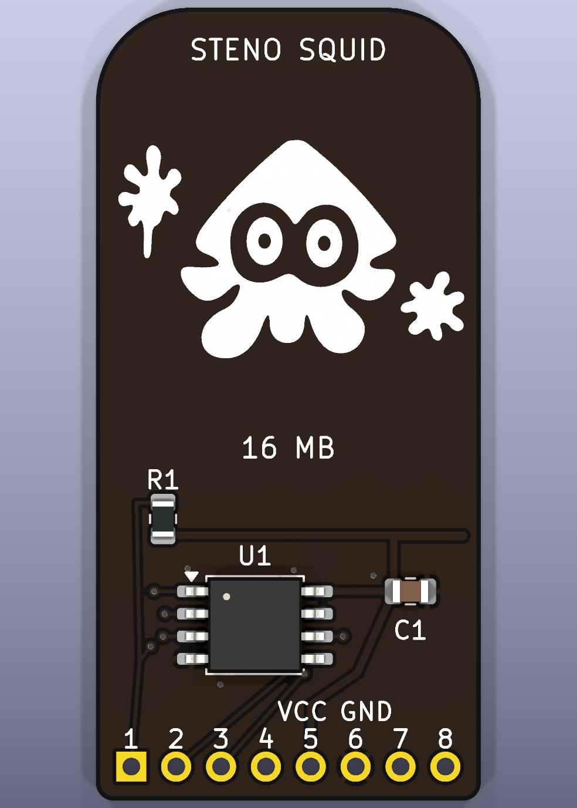
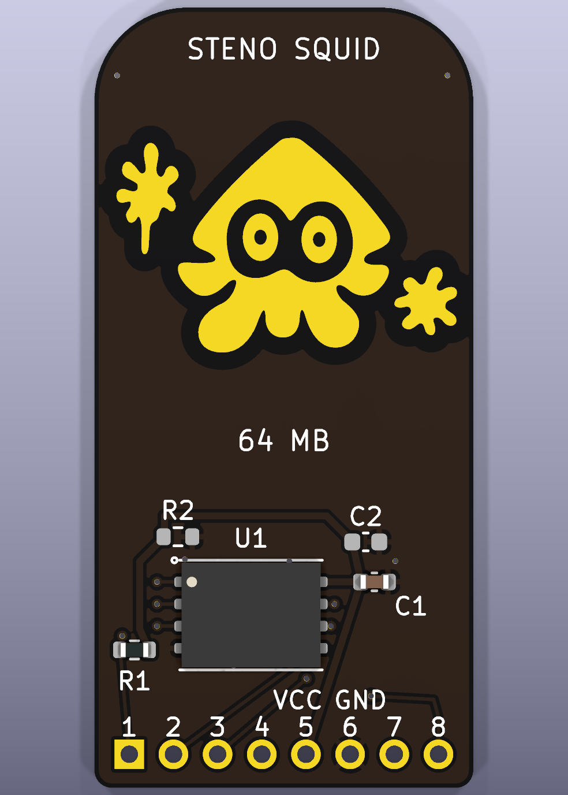

# Steno Squid PCB

Build a hand-soldered QSPI flash add-on for Javelin stenography on the left half of the **Boardsource Wireless Corne SMT**. Steno Squid sits on top of the switch plate and connects through the eight-contact expansion slot. Choose **16 MB or 64 MB** of flash.

## Choose a board

Both DIY boards use exposed SOIC leads and 0805 passives. Use a fine-tip iron, flux and tweezers. Order a bare PCB using the ZIP for your chosen capacity.

| Capacity | Flash package | Board files | Parts |
|---|---|---|---|
| **16 MB** | Winbond W25Q128JVSIQ, SOIC-8 (208 mil) | [Bare-board ZIP](manufacturing/2026-11-18/diy-bare/stenosquid-16mb-diy-bare.zip) · [KiCad and fit template](variants/16mb-diy-soic/README.md) | [16 MB BOM](variants/16mb-diy-soic/BOM.csv) |
| **64 MB** | Winbond W25Q512JVFIQ, SOIC-16 (300 mil) | [Bare-board ZIP](manufacturing/2026-11-18/diy-bare/stenosquid-64mb-diy-bare.zip) · [KiCad and fit template](variants/64mb-diy-soic/README.md) | [64 MB BOM](variants/64mb-diy-soic/BOM.csv) |

### Parts for one board

| Ref. | Qty. | Part |
|---|---:|---|
| U1 | 1 | The Winbond flash listed for your PCB above |
| C1 | 1 | 100 nF X7R ceramic capacitor, 0805. BOM part Yageo `CC0805KRX7R9BB104` |
| R1 | 1 | 10 kΩ, 1% resistor, 0805. BOM part Yageo `RC0805FR-0710KL` |

## Factory-assembled 16 MB and 64 MB boards

These low-profile WSON builds have assembly packages for the flash, decoupling capacitor and CS# pull-up. Everything you need to have JLPCB manufacture it!\
This is much more expensive than the DIY build!

| **16 MB · White silkscreen** | **64 MB · Gold ENIG artwork** |
|---|---|
|  |  |
| [KiCad and BOM](pcb/README.md) · [Gerber ZIP](manufacturing/2026-11-18/16mb-silkscreen/16mb-silkscreen-gerbers.zip) · [BOM and placement](manufacturing/2026-11-18/16mb-silkscreen/) | [KiCad and BOM](variants/64mb-enig/README.md) · [Gerber ZIP](manufacturing/2026-11-18/64mb-gold/64mb-gold-gerbers.zip) · [BOM and placement](manufacturing/2026-11-18/64mb-gold/) |

## Host wiring and firmware

Viewed from above, the contacts run along the bottom with pin 1 on the left.

| Contact | Host GPIO or rail | Signal |
|---|---|---|
| 1 | P0.07 | CS# |
| 2 | P0.21 | IO0 |
| 3 | P0.12 | IO3 |
| 4 | P0.23 | IO1 |
| 5 | VCC switched by P0.31 | VCC |
| 6 | GND | GND |
| 7 | P0.19 | CLK |
| 8 | P0.05 | IO2 |
