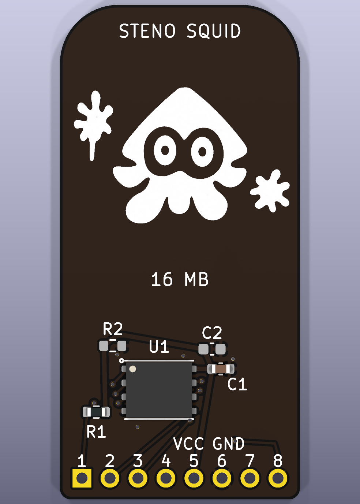

# StenoSquid-PCB

**Approved outline:** all six PCB projects use 21.78 × 44.82 mm, exactly 1.5 mm shorter than the original 46.32 mm, with R5.35 far-end corners and fixed headers. Owner approved on 2026-11-17.

**ZMK firmware for StenoSquid-PCB!: https://github.com/disarmyouwitha/StenoSquid**

Steno Squid adds 16 MB of QSPI flash for Javelin stenography to the left half of the Boardsource Wireless Corne SMT. It is an independent community accessory designed to sit flush on top of the switch plate.

[KiCad project](pcb/steno-squid.kicad_pro) · [Actual-size fit template](pcb/previews/plate-fit-1to1.svg) · [STEP model](pcb/steno-squid.step) · [BOM](pcb/BOM.csv)

**Larger-capacity options:** complete [32 MB and 64 MB KiCad drafts](variants/README.md) use a shared 8 × 6 mm WSON footprint and the same eight host contacts. Choose the matching BOM for the desired capacity. The 16 MB baseline below retains its original footprint. [Package and power review](docs/capacity-variants.md)

## Hardware

- Rev D uses a **21.78 × 44.82 mm approved outline with no ears or USB notch**, R5.35 corners away from the header, R1 header-end corners and 1.0 mm board thickness. The switch-facing edge keeps a net 1.12 mm trim from the original full-ear outline; the pin-8 edge is widened 0.88 mm so its silkscreen gap matches the one at pin 1. The opposite edge and all header centres stay fixed. Components face up, with STENO SQUID silkscreened above Pop and the 16 MB flash capacity below it.
- Eight soldered pins mate with the host sockets through the plate slot. Viewed from above with USB-C at the top, the contact row is at the bottom and pin 1 is on the left. The owner confirmed all eight template contacts align and checked that their socket stack allows the daughterboard to sit flush on the plate. The 2.54 mm pitch and nominal 2.20 mm pin-1 offset are retained. [Fit record](docs/plate-geometry.md)
- The W25Q128JVPIQ WSON flash, 100 nF decoupling capacitor C1 and 10 kΩ CS pull-up R1 are fitted. The optional bulk capacitor C2 and bleed resistor R2 start unpopulated. The breadboard rail test determines whether either is needed.
- The 0.40 mm supply path from the header through C1 to the flash stays on the top copper layer. Ground pours on both layers now extend under the whole board, including the Pop artwork area, for a uniform soldermask finish; the Pop artwork itself dropped its 6 small splat dots. An [ENIG gold-artwork variant](variants/enig/README.md) exposes Pop and the two remaining splats as isolated gold copper behind a 1 mm keepout halo, while this baseline board keeps Pop, STENO SQUID and 16 MB as plain silkscreen for lower-cost manufacture. The same gold treatment is also available for the [32 MB](variants/32mb-enig/README.md) and [64 MB](variants/64mb-enig/README.md) capacity options.

## Host interface

| Contact | Host GPIO or rail | Flash signal | Flash pad |
|---|---|---|---|
| 1 | P0.07 | CS# | 1 |
| 2 | P0.21 | IO0 | 5 |
| 3 | P0.12 | IO3 | 7 |
| 4 | P0.23 | IO1 | 2 |
| 5 | VCC switched by P0.31 | VCC | 8 |
| 6 | GND | GND | 4 |
| 7 | P0.19 | CLK | 6 |
| 8 | P0.05 | IO2 | 3 |

Use this map for the Adafruit flash breakout proof of concept. The left expansion header serves QSPI. The right half can retain its display. The firmware's `Boardsource-*` builds cover the Boardsource board: the default and no-display halves, the logging left and both flash probes. They build in CI, and runtime testing is pending. [Boardsource host documentation](https://boardsource.xyz/blogs/guides/wireless-smt-corne-docs) · [Firmware builds](https://github.com/disarmyouwitha/StenoSquid/actions/workflows/build.yml)

## Prototype status

KiCad reports zero ERC, DRC, unconnected items and schematic-parity issues with every ERC and DRC category enabled. Paper-template header alignment and socket stack are owner-checked; final populated-board fit, power and Bluetooth performance remain to be verified. [CAD validation](pcb/validation.json)

1. Use the revised fit template at 100% to check the trimmed edge and solid top with keycaps and USB plug fitted. Header alignment and the owner's socket stack are confirmed; record the exact socket part and mating pin length before procurement. Verify the final populated-board assembly.
2. Check the switched rail on USB and battery. Measure voltage under load, control polarity, shared loads and discharge with the breakout before deciding whether to populate R2 or C2.
3. Identify the host antenna and check its specified clearance against the plate, pins and daughterboard. Compare host and split Bluetooth performance with the module fitted and removed under the same conditions.
4. Review the WSON land pattern and stencil with the assembler. On the prototype, confirm flash ID, quad mode, readback and dictionary integrity across power cycles.

[Pre-order checklist](docs/pre-order-checklist.md) · [Mounting and CAD notes](pcb/README.md) · [Electrical and RF review](docs/design-review.md) · [Source credits and license status](ATTRIBUTION.md) · [Design history](docs/history.md)
