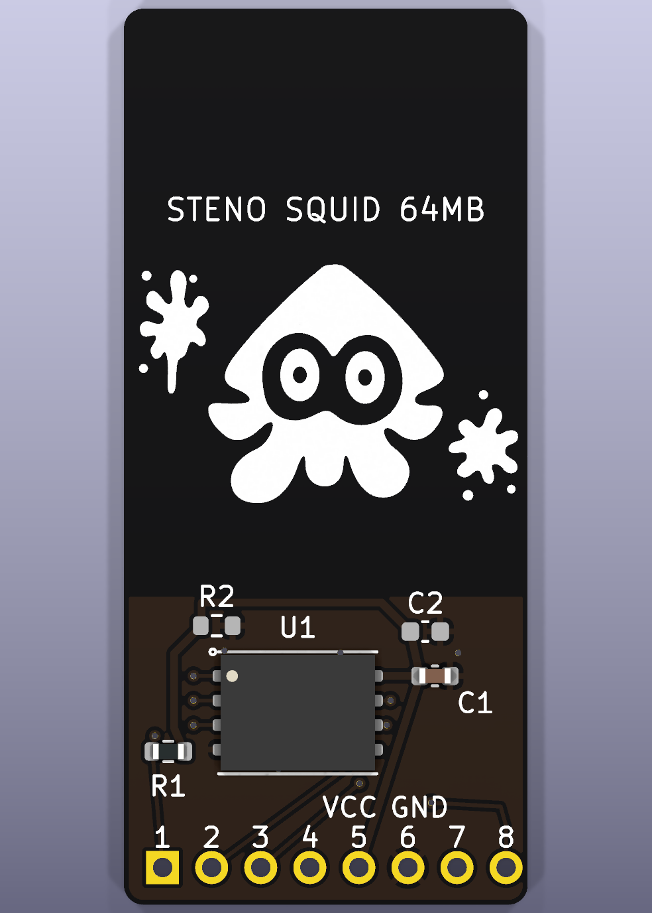
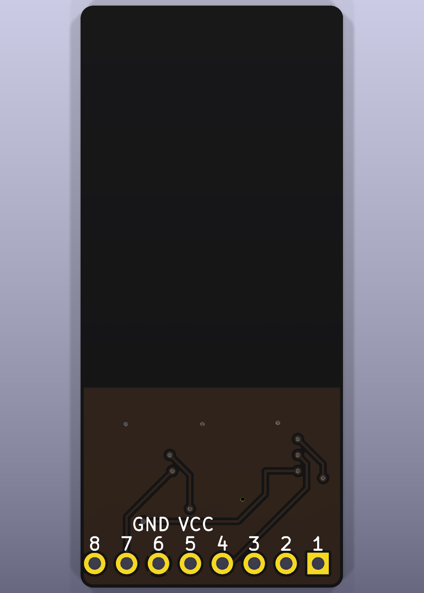

# Steno Squid 64 MB

Complete routed Rev D capacity draft with **W25Q512JVEIQ**, WSON-8 8 × 6 mm. Select this exact package when purchasing assembly.

[KiCad project](steno-squid.kicad_pro) · [Board](steno-squid.kicad_pcb) · [Schematic SVG](previews/steno-squid.svg) · [BOM](BOM.csv) · [STEP](steno-squid.step) · [Checks](validation.json) · [Fit template](previews/plate-fit-1to1.svg)

The 32 MB and 64 MB drafts share copper and footprint geometry. The original eight Boardsource contacts are preserved. C1 is 100 nF, R1 is 10 kΩ, and C2/R2 remain DNP. The shared 20.9 × 46.32 mm full-length, no-ears outline includes the 2 mm switch-side trim. Header centres stay fixed and Pop is recentered. The native board labels this capacity as 64MB.

[SMT BOM draft](assembly-bom-draft.csv) · [SMT position draft](assembly-positions-draft.csv). These include fitted U1/C1/R1; fit J1 manually after measuring the host stack. Review placement rotation and WSON stencil with the assembler. STEP excludes DNP components; PCB renders may show their optional footprints/models.

The 64 MB part has a higher specified read-current limit than the 32 MB part. Verify the actual host switched rail under read/program/erase load before release. [Package/power review and firmware handoff](../../docs/capacity-variants.md)

The owner checked paper-template header alignment and a flush socket stack. This CAD draft still needs revised-outline/populated-board fit, switched-rail, RF and assembly qualification. Production Gerbers and drill files have not been generated. [Compare capacities](../README.md)
