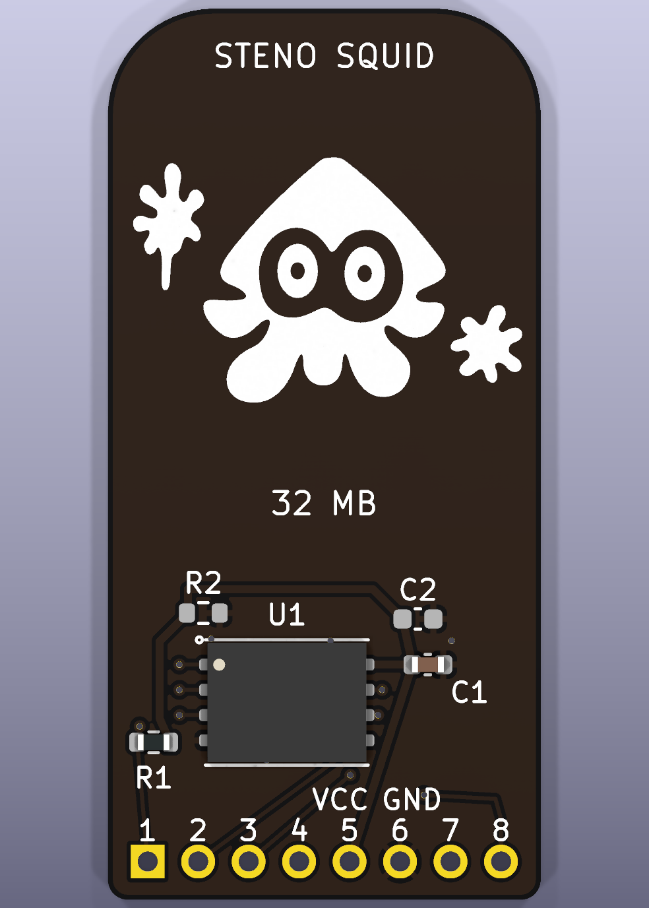
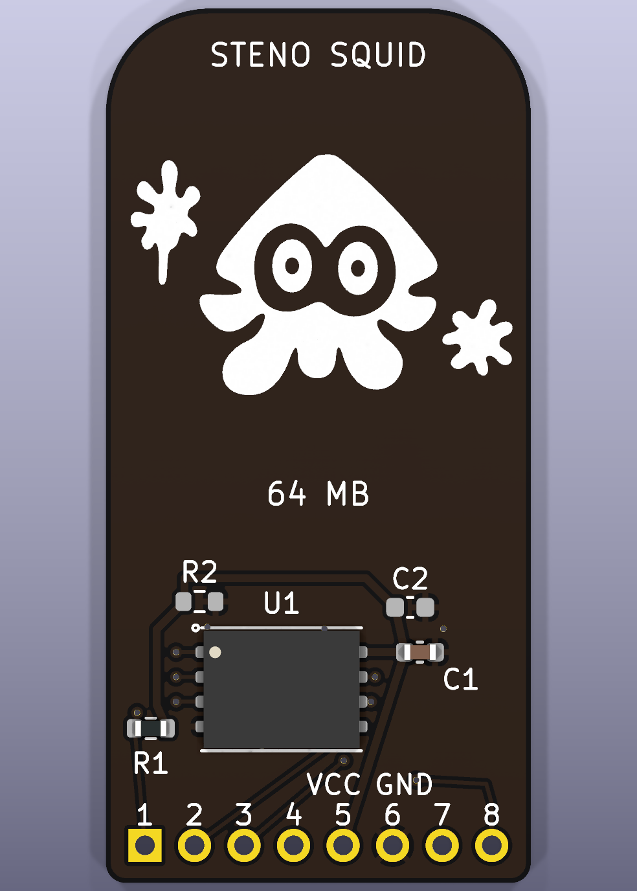

# Capacity options

These complete 32 MB and 64 MB drafts derive from the locked Rev D electrical design and the owner's 2026-11-16 fit update. All capacities share the 21.78 × 44.82 mm full-length, no-ears outline, with a net 1.12 mm trim from the switch-facing edge (the pin-8 edge was widened 0.88 mm from the original 2 mm cut to match the pin-1 silkscreen gap). Header centres stay fixed and Pop is recentered; the ground pour extends under the whole board and the 6 small splat dots were removed from the shared artwork. The 16 MB project remains in [pcb](../pcb/README.md). Each capacity also has an ENIG gold-artwork sibling — [16 MB](enig/README.md), [32 MB](32mb-enig/README.md), [64 MB](64mb-enig/README.md) — that exposes Pop and the splats as isolated gold copper behind a 1 mm keepout halo instead of silkscreen, with identical halo/Pop geometry across all three; everything else about each pair is unchanged.

| Capacity | Flash to populate | Project | BOM | Checks |
|---|---|---|---|---|
| 32 MB / 256 Mbit | W25Q256JVEIQ | [32 MB](32mb/steno-squid.kicad_pro) | [BOM](32mb/BOM.csv) | [Validation](32mb/validation.json) |
| 64 MB / 512 Mbit | W25Q512JVEIQ | [64 MB](64mb/steno-squid.kicad_pro) | [BOM](64mb/BOM.csv) | [Validation](64mb/validation.json) |

Both use the same WSON-8 package-E footprint and copper routing. The capacity marking, selected U1, schematic, BOM and interface metadata distinguish the two projects. The host still needs exactly eight contacts. Neither uses the taller SOIC-16 breadboard part. These 8 × 6 mm parts need the new layout; they are not approved drop-in replacements for the 16 MB project's 6 × 5 mm footprint.

| 32 MB | 64 MB |
|---|---|
|  |  |

Each directory includes the native schematic and board, local symbols and footprints, flash STEP model, assembled-board STEP, schematic SVG, front/back renders, actual-size fit template, full BOM, draft SMT positions and ERC/DRC/netlist reports. Open the project from its own directory so its local libraries resolve.

The designs are complete routed drafts. The owner checked paper-template header alignment and a flush socket stack. Revised-outline/populated-board fit, switched supply, RF behavior and assembler approval remain pending. Production Gerbers and drill files are deferred. [Package, power and firmware handoff](../docs/capacity-variants.md)

To regenerate from the 16 MB baseline:

```sh
python3 tools/build_capacity_variants.py
python3 tools/check_capacity_variants.py
```

The build command replaces the generated CAD in both directories. Preserve any manual edits before rebuilding. The check command refreshes all six projects across three capacities, including review artifacts and draft assembly positions; it generates no Gerbers. It verifies that the 32/64 MB versions share copper, that all capacities match the current Rev D outline and Pop artwork placement, and that the eight host contacts agree with the schematic and board.

The owner approved the shared outline on 2026-11-17: **1.5 mm total removed from the original 46.32 mm length**, leaving **44.82 mm**, with **R5.35 far-end corners**. Header centres, electrical routing and this project's artwork/finish are preserved. Final populated fit, powered and RF testing remain pending.
